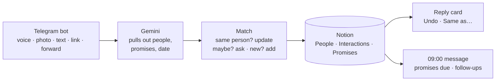

**People Inbox** · Personal tool by Rishul Nayak · November 2026 · Costs ₹0 to run

# Send a 30-second voice note after you meet someone, and they land in Notion with a follow-up date

- **Logging is the bottleneck** of every networking system → one voice note, no typing, no forms
- **Duplicates ruin a contact list** → a person is matched by LinkedIn, email, phone or name; if unsure, the card asks
- **Promises get forgotten** → "I'll send her the deck" becomes a Promise row with a due date, and the 09:00 message reminds you

## The networking rules it runs on

From the networking skill and the four books it is built on. The bot drafts; you decide and send.

| Rule | Where it comes from | What the bot does |
|---|---|---|
| Follow up within 24 hours | Never Eat Alone | The card includes a ready follow-up draft; a new person's next contact is tomorrow |
| Give first, in small useful gifts | Give and Take | 🎁 line: up to 2 ideas to help, only from what you said |
| Rare common ground builds trust | Give and Take (uncommon commonality) | Saves shared links (Jabalpur, IIT Bombay…) in **Common ground** |
| Deliver every promise | Never Eat Alone | Every promise becomes a dated row; due ones appear at 09:00 |
| Keep in touch by system, by tier | The Startup of You, Never Eat Alone | Next contact = tier days; 09:00 lists 3 people to ping, Allies first |
| Never "manage" your inner circle | The networking skill | Inner circle and Dormant get no reminders |

## What it saves

| Notion table | One row per | Filled in by the bot |
|---|---|---|
| **People** | person | Name, Tier (new = Tier 1), World, Company, Role, How we met, Cares about, Personal notes, Ideas to help, Common ground, LinkedIn, Email, Phone, Last contact, Next contact |
| **Interactions** | voice note or message | Summary, Date, Type, People, Event, Source, Status, Raw (the transcript) |
| **Promises** | promise | What, Who (Me / Them), Person, Due, Done |

- **Next contact**: a new person's is tomorrow (the follow-up). After that, last contact + the tier's days: Ally 21 · Tier 1 30 · Tier 2 90 · Tier 3 365 (in [`config.yaml`](config.yaml))
- **Existing people are never overwritten**: empty fields get filled, notes get a new dated line, and **Undo** restores the exact old values
- **Undated promises**: yours are due in 2 days, theirs get a check-in after 7

## Use it

| You want to… | Do this |
|---|---|
| Log someone | Voice note to the bot: who, where, what they care about, what you promised |
| Save a card or a profile | Send a photo or a screenshot. Or share the LinkedIn profile → Telegram → the bot |
| Answer the bot's question | Reply to its card |
| Tag a whole event | `/event AI meetup` (4 hours) · `/event off` |
| Before a meeting | `/who Neha` |
| See what you owe | `/promises` |

The bot checks Telegram every 10 minutes from 06:30 to 00:20 IST. Need it now: Actions → **People Inbox bot** → **Run workflow**.

## What it costs to run

- **GitHub Actions** (public repo): unlimited free minutes. About 110 short runs a day
- **Gemini `gemini-3.5-flash-lite`**: 1 request per note, out of ~500 free a day (shared with Content Inbox if you use the same key)
- **Telegram Bot API** and **Notion API `2026-03-11`**: free

**Privacy:** people's data lives only in Notion. Keys live in GitHub Secrets. Run logs are public, so they show counts only. On Gemini's free tier, Google may use what you send to improve its products: keep health or money details out of voice notes.

## Set it up (once, ~10 minutes)

1. **Bot:** Telegram → @BotFather → `/newbot` → copy the token.
2. **Secrets:** repo → Settings → Secrets and variables → Actions → add `TELEGRAM_BOT_TOKEN`, `NOTION_TOKEN`, `GEMINI_API_KEY` (the last two can be the same values as Content Inbox).
3. **Notion:** Actions → **Setup Notion (one time)** → Run workflow. It makes a **People Inbox** page under Life → Professional with the 3 tables and commits their IDs.
4. **Your ID:** message your bot "hi", then Actions → **People Inbox bot** → Run workflow. It replies with your ID. Add it as the `TELEGRAM_OWNER_ID` secret. The bot ignores everyone else.
5. **Test:** send a voice note → Run workflow → you get a card, and the rows are in Notion.

**If a run fails:** Actions → the red run → the **python bot.py** step shows the error type. `401` from Notion = wrong token · `404` = the integration isn't connected to Life → Professional · `Missing … secret` = add it. A note that hit a Gemini limit waits as **Pending** and is retried on the next runs.

Code: **`bot.py`** reads Telegram and answers · **`extract.py`** talks to Gemini · **`match.py`** finds duplicates · **`store.py`** writes Notion, Undo and Merge · **`digest.py`** sends the 09:00 message · **`tests/`** has 19 tests that run on every push.
